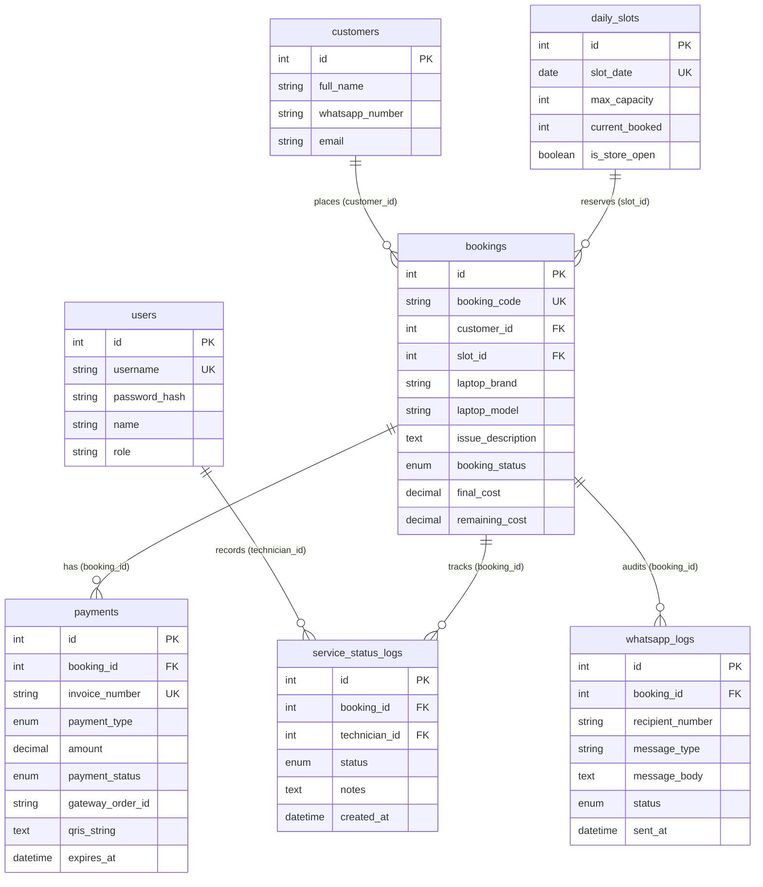

<div align="center">

# 💻 RimTech Comp
### Sistem Informasi Booking Layanan Servis Laptop Berbasis Web dengan Integrasi Payment Gateway QRIS Dinamis dan WhatsApp Gateway

[](https://nextjs.org/)
[](https://www.typescriptlang.org/)
[](https://tailwindcss.com/)
[](https://www.prisma.io/)
[](https://www.mysql.com/)
[](https://midtrans.com/)
[](https://fonnte.com/)

<p align="center">
  <b>Solusi reservasi servis laptop modern, anti-antrean, transparan, dan terotomasi penuh untuk RimTech Comp.</b>
</p>

[Fitur Utama](#-fitur-utama) •
[Arsitektur & Keamanan](#-arsitektur--keamanan-sistem) •
[Skema Database](#-skema-basis-data) •
[Panduan Instalasi](#-panduan-instalasi--menjalankan-proyek) •
[Mode Simulasi](#-mode-simulasi-offline-demo) •
[Struktur Direktori](#-struktur-direktori)

---

</div>

## 📌 Latar Belakang & Masalah

Pada operasional bengkel servis laptop konvensional, sering ditemukan kendala operasional seperti:
1. **Antrean fisik yang tidak teratur**, menyebabkan penumpukan unit laptop di toko melebihi kapasitas kerja teknisi.
2. **Tingginya angka pembatalan sepihak (*no-show booking*)** karena tidak adanya komitmen awal dari pelanggan.
3. **Kurangnya transparansi progres perbaikan**, sehingga pelanggan harus berulang kali bertanya melalui pesan pribadi.
4. **Pencatatan kas dan status unit yang tercecer secara manual**.

**RimTech Comp** hadir sebagai solusi sistem informasi berbasis web terintegrasi yang mendigitalisasi seluruh alur kerja: mulai dari reservasi kuota slot harian, pembayaran DP QRIS dinamis secara real-time, pelacakan progres fisik unit secara mandiri, hingga notifikasi WhatsApp otomatis di setiap tahapan servis.

---

## ✨ Fitur Utama

### 👤 1. Portal Pelanggan Publik (Customer Portal)
- 📅 **Kalender Ketersediaan Kuota Real-Time:** Menampilkan ketersediaan slot 30 hari ke depan secara dinamis dengan status buka/tutup toko dan sisa kuota harian.
- 📝 **Formulir Reservasi Multi-Tahap:** Pengisian data diri, merek/model laptop, deskripsi keluhan, dan jam drop-off dengan validasi Zod ketat.
- 💳 **Pembayaran DP QRIS Dinamis (Midtrans API):** Pembuatan QRIS otomatis sebesar Rp 50.000 dengan timer kedaluwarsa 15 menit dan polling status real-time.
- 🎟️ **E-Ticket Resmi Bukti Booking:** Tampilan bukti reservasi resmi berisi ringkasan pesanan, kode booking unik `RMC-YYYYMMDD-XXX`, dan instruksi serah terima unit.
- 🔍 **Pelacakan Status Mandiri (Tracking Portal):** Pelanggan dapat memantau progres servis via Kode Booking atau Nomor WhatsApp dengan visual stepper 5 tahap:
  `Menunggu Penyerahan` ➔ `Sedang Didiagnosa` ➔ `Sedang Diperbaiki` ➔ `Selesai` ➔ `Sudah Diambil`.

### 🛠️ 2. Panel Pengelolaan Toko (Admin & Technician Dashboard)
- 📊 **Dashboard Analitik:** Ringkasan metrik antrean verifikasi, unit dalam pengerjaan, unit siap diambil, dan total omzet kas toko.
- 📋 **Manajemen Antrean & Verifikasi:** Filter tab status (`Perlu Tindakan`, `Dikerjakan`, `Selesai`), aksi Konfirmasi booking, dan aksi Tolak booking dengan alasan penolakan.
- 🔧 **Pembaruan Progres Bertahap:** Teknisi dapat mengunggah catatan perbaikan per tahap (`Diagnosa`, `Perbaikan`, `Menunggu Sparepart`).
- 💰 **Kalkulasi Otomatis Sisa Pelunasan:** Saat status servis `SELESAI`, teknisi menginput total biaya akhir; sistem otomatis memotong DP Rp 50.000 dan menghitung sisa pelunasan.
- 🤝 **Pencatatan Pelunasan Offline:** Pencatatan pelunasan tunai (`CASH`) atau non-tunai (`TRANSFER`) di toko saat serah terima unit laptop.
- 🗓️ **Slot & Holiday Manager:** Kalender 30 hari untuk menyesuaikan kapasitas unit per hari atau mengatur hari libur operasional.
- 💵 **Rekapitulasi Keuangan:** Laporan audit kas dengan filter transaksi `DP_QRIS` vs `PELUNASAN_OFFLINE`.
- 📲 **Audit Log Notifikasi WhatsApp:** Riwayat pengiriman notifikasi dengan status `SUCCESS` / `FAILED` dan tombol kirim ulang manual (*Resend*).

---

## 🛡️ Arsitektur & Keamanan Sistem

Sistem ini dirancang dengan standar keamanan web modern:

- 🔒 **Database Concurrency Lock (Anti Overbooking):** Pemesanan slot menggunakan *atomic raw conditional SQL update* (`WHERE current_booked < max_capacity`) di dalam transaksi database ACID, mencegah *race condition* saat banyak pengguna memesan bersamaan.
- 🛑 **Anti Slot-Hoarding & IP Rate Limiting:** Pembatasan maksimal 1 reservasi aktif per nomor WhatsApp dan pembatasan frekuensi request (maksimal 5 request/menit per IP).
- 🔑 **Autentikasi Aman:** Menggunakan NextAuth v5 (Auth.js) dengan hashing kata sandi **Bcrypt** (Salt rounds 10), sesi JWT terenkripsi di HTTP-Only cookie, dan proteksi brute-force lockout 60 detik.
- 🛡️ **Edge Middleware Guard:** Seluruh rute `/admin/*` dijaga di lapisan terluar (*Edge Middleware*) sebelum komponen halaman sempat dieksekusi.
- 🔐 **Timing-Safe Webhook Verification:** Verifikasi notifikasi HTTP callback Midtrans menggunakan `crypto.timingSafeEqual` pada signature SHA512.
- 👁️ **Perlindungan Privasi Pelanggan (PII Masking):** Nama pelanggan disensor sebagian (contoh: `B*** S******o`) pada halaman pelacakan publik untuk mencegah scraping data.
- 🌐 **HTTP Security Headers:** Dikonfigurasi dengan `X-Frame-Options: DENY` (Anti-Clickjacking), `X-Content-Type-Options: nosniff`, dan `Referrer-Policy`.

---

## 🗄️ Skema Basis Data

Sistem menggunakan 7 model relasional yang dinormalisasi pada basis data MySQL melalui Prisma ORM:



---

## 🚀 Panduan Instalasi & Menjalankan Proyek

### Prasyarat Sistem
- **Node.js:** Versi 18.18.0 atau lebih tinggi (disarankan Node.js 20 LTS).
- **Package Manager:** `npm` (atau `pnpm` / `yarn`).
- **Database Server:** MySQL 8.0+ (Dapat menggunakan Laragon, XAMPP, atau Docker).

### Langkah-langkah Instalasi

1. **Clone Repositori:**
   ```bash
   git clone https://github.com/putrafebriansyah40-beep/Rimtech-Comp.git
   cd Rimtech-Comp
   ```

2. **Install Dependensi:**
   ```bash
   npm install
   ```

3. **Konfigurasi Environment Variable:**
   Salin file `.env.example` menjadi `.env`:
   ```bash
   cp .env.example .env
   ```
   Buka file `.env` dan sesuaikan koneksi database MySQL:
   ```env
   DATABASE_URL="mysql://root:@localhost:3306/rimtech_comp"
   AUTH_SECRET="D14Y8JIbYnafpQpgvInz9JaGnu7m/0m0dc6lafbpS2Y="
   NEXT_PUBLIC_APP_URL="http://localhost:3000"
   DP_AMOUNT=50000
   ```

4. **Inisialisasi & Migrasi Basis Data:**
   Buat database `rimtech_comp` di MySQL, lalu jalankan sinkronisasi skema Prisma:
   ```bash
   npx prisma db push
   ```

5. **Jalankan Seeder Data Awal (Akun Admin):**
   ```bash
   npm run db:seed
   ```
   *Kredensial bawaan admin/teknisi:*
   - **Username:** `admin`
   - **Password:** `admin123`

6. **Jalankan Server Development:**
   ```bash
   npm run dev
   ```
   Buka peramban Anda di [http://localhost:3000](http://localhost:3000).

---

## 🧪 Mode Simulasi (Offline Demo)

Proyek ini dilengkapi **Dual-Engine Architecture** sehingga dapat diuji dan didemonstrasikan 100% lancar tanpa memerlukan koneksi gateway berbayar:

| Komponen Gateway | Mode Live (Production) | Mode Simulasi (Demo / Pengujian) |
| :--- | :--- | :--- |
| **Midtrans (QRIS)** | Mengisi `MIDTRANS_SERVER_KEY` di `.env`. Memanggil API resmi Midtrans Core API. | Kosongkan `MIDTRANS_SERVER_KEY`. Sistem menghasilkan QR code lokal dan tombol "Simulasi Bayar Berhasil". |
| **Fonnte (WhatsApp)** | Mengisi `FONNTE_TOKEN` di `.env`. Mengirim pesan WhatsApp fisik ke nomor HP pelanggan. | Kosongkan `FONNTE_TOKEN`. Pesan dicetak ke console & dicatat ke tabel `whatsapp_logs` dengan status `SUCCESS`. |

> [!NOTE]
> Mode simulasi secara otomatis terkunci dan **tidak dapat dieksekusi** pada lingkungan produksi (`NODE_ENV=production`) demi menjamin keamanan transaksi toko.

---

## 📂 Struktur Direktori

```text
rimtech-comp/
├── prisma/
│   ├── schema.prisma          # Skema basis data & relasi model Prisma
│   └── seed.ts                # Seeder akun admin & kalender slot awal
├── src/
│   ├── app/                   # Next.js App Router
│   │   ├── (public)/          # Landing page (/)
│   │   ├── booking/           # Alur reservasi & pembayaran DP QRIS
│   │   ├── lacak/             # Portal pelacakan progres servis mandiri
│   │   ├── admin/             # Panel teknisi & manajemen toko
│   │   │   ├── login/         # Halaman autentikasi admin
│   │   │   └── (panel)/       # Dashboard, Bookings, Slots, Transaksi, WA Logs
│   │   └── api/               # Route Handlers (Slots, Webhook, Booking Status)
│   ├── components/            # Komponen UI (Navbar, Timeline, BookingForm, dll.)
│   ├── lib/                   # Layanan & Logika Bisnis Server
│   │   ├── services/          # booking.ts, slot.ts, payment.ts, whatsapp.ts
│   │   ├── actions/           # Next.js Server Actions (admin.ts)
│   │   ├── validations.ts     # Skema validasi Zod
│   │   ├── rate-limit.ts      # In-Memory Rate Limiter
│   │   └── prisma.ts          # Prisma Client Singleton
│   ├── auth.ts                # Konfigurasi NextAuth v5 (Auth.js)
│   └── middleware.ts          # Edge Security Middleware
├── public/                    # Aset statis & logo
├── next.config.ts             # Konfigurasi Next.js & HTTP Security Headers
├── tailwind.config.ts         # Konfigurasi styling Tailwind CSS
└── package.json               # Daftar dependensi & script proyek
```

---

## 👥 Pengembang & Kontribusi

Proyek ini dikembangkan oleh **Putra Febriansyah** sebagai bagian dari pemenuhan Proyek Sistem Informasi Semester 5.

* Repositori GitHub: [https://github.com/putrafebriansyah40-beep/Rimtech-Comp](https://github.com/putrafebriansyah40-beep/Rimtech-Comp)
* Studi Kasus: Bengkel Servis Laptop RimTech Comp

---

## 📄 Lisensi

Didistribusikan di bawah Lisensi MIT. Lihat file `LICENSE` untuk informasi lebih lanjut.
